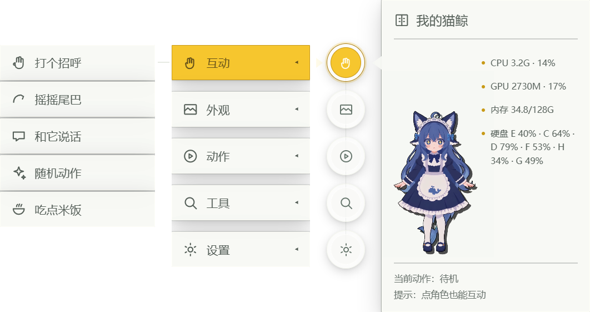

# 猫鲸桌宠 · Tauri (Rust) 版

> 这是与 Electron 主线**并行**的 Rust 分支：功能对齐 v0.7.0，独立构建、独立运行，
> 不改动主线的 `app/`、`web/`、`skin-editor/`。主线仍在 `main`，本目录只存在于 `feat/tauri-rust`。

当前 exe 为 **5.30 MiB（5,561,856 字节）**。SAO 菜单已按原版重做为四列、五分类 21 项；文件搜索和聊天使用原版风格独立浮窗，综合面板保留系统监控、环境自检、角色卡和 Agent 看板等功能。

双击 `catwhale-poc.exe` 运行。目标机需要 WebView2 Runtime，Windows 11 通常已自带。



## 一、目录结构

```text
tauri/
├─ src-tauri/               Rust 源码（13 个模块，约 1.2 万行）
│  ├─ src/main.rs           窗口/托盘/穿透/皮肤/行为引擎
│  ├─ src/media.rs          媒体演出探测（系统媒体会话 + 音频电平）
│  ├─ src/chat.rs           DeepSeek 聊天（DPAPI 加密凭据）
│  ├─ src/harness.rs        DeepSeek Harness 子进程
│  ├─ src/dock.rs           Agent 看板（127.0.0.1:8770/state）
│  ├─ src/persona.rs        角色卡
│  ├─ src/sysinfo.rs        CPU/GPU/内存/硬盘读数
│  ├─ src/everything.rs     Everything 搜索
│  ├─ src/boot_guard.rs     启动看门狗（L1/L2/L3 降级档）
│  ├─ src/gamemode.rs       游戏模式
│  ├─ src/envcheck.rs       环境自检
│  ├─ src/feature_config.rs 功能开关
│  └─ src/update.rs         更新检查
├─ frontend/                六个 HTML（构建时内嵌进 exe，含 walk-select.html）
├─ scripts/                 verify4.sh 验收基线 + ev.py CDP 选择器
├─ reference/shots/         验收截图
└─ build.sh                 构建入口
```

## 一·二、运行时必须保留的文件

发布形态下 exe 旁需要这些文件：

```text
catwhale-poc.exe          主程序
WebView2Loader.dll        必须与 exe 同目录（Tauri 依赖）
assets/es.exe             Everything 搜索组件（不入库，发布包内附）
frontend/assets/          28 个外置内置回落 WebM（其中 walk_left/walk_right 随仓库入库）
```

`builtin_asset_dir()` 返回的是 **frontend 目录本身**，前端再拼 `assets/<name>`。
两边各拼一层就会变成 `frontend/assets/assets/walk_left.webm`（404，走动静默退回 run）——
v0.7.0 第一次打包就是这个错。判定以「该目录下真的有 `assets/idle.webm`」为准，
空目录会被跳过；`cargo test` 里 `builtin_asset_dir_tests` 专门钉住这条约定。

HTML 已嵌入 exe，回落视频没有内嵌（内嵌会让 PE 增加约 65 MiB）。移动程序时请移动整个目录。

最终 exe SHA-256：

```text
1072a1728a39ecc2399a948d06497720fe596e65e4fb99a90c57ed4053ea001d  （v0.6.1 历史值）
f21b01e99fb8c9eb423b3741ebc4dbbedbbf0b4e67c9cfd7b0574e478c23343d  （v0.7.0 交付包内 exe）
```

## 二、桌宠操作

| 操作 | 效果 |
|---|---|
| 按住角色拖动 | 切换抓手动作并跟随鼠标，松手播落下动作 |
| 双击角色 | 随机互动动作 |
| 右键角色 | 打开/关闭 SAO 菜单，不抢当前外部应用前台 |
| Esc | 第一次收三级菜单，再次关闭 SAO 菜单 |
| 点击其他窗口 | 菜单失焦关闭 |
| 托盘右键 | 显示/隐藏、互动、换肤、皮肤目录、自启、尺寸和退出 |

皮肤继续读取 `%APPDATA%\桌宠\skins`，与 Electron 版共用。该目录是用户资产，测试或构建流程不应改写。

## 二·二、桌面走动（v0.7.0）

- 设置 → **桌面走动**：默认关闭；可框选当前屏幕的活动范围，范围持久化到 `walk.json`。
- 框选使用按需创建的临时透明窗 `walk-select`（覆盖当前显示器工作区），选完 / Esc / 失焦立即销毁，不做常驻全屏窗；结束后恢复主窗点击穿透。
- 范围是二维矩形，窗口整体被夹在范围内；反向拖拽（从右下往左上）同样有效。换屏、缩放、拖动、游戏模式都会重新检查边界。
- 聊天里发送 **「向左走」「往右走 200 像素」「停下」**（也支持上/下、`px`、省略距离默认 200）由 Rust 本地解析执行，不依赖 API；只有用户本次输入会进入解析，AI 输出与历史重放没有入口。「停下」会同时暂停巡游，设置页可再次开启。
- 动画使用独立朝向 `walk_left` / `walk_right`（576×960、24fps、32 帧 / 1.333s、VP9+alpha），文件在 `frontend/assets/walk_left.webm`、`walk_right.webm`，**随仓库入库**（`tauri/.gitignore` 只放行这两个）。walk 动画不受菜单/浮窗镜像影响，不会被翻反。
- **手动交互优先是每拍判定的**：`tick` 每 33ms 检查 `Pet.dragging` / `Pet.menu_open`，为真就清掉在途目标并跳过本拍；只在 `drag_begin` 取消一次不够（长按 1.8 秒后巡游会重新抽目标，把按着的窗口搬走）。
- **范围装不下角色画布时不再静默改用整屏**：`area_fit` 返回 `TooSmall`，巡游暂停、走动指令被拒绝并回一条可读原因（含「范围已保留」），范围本身不动；尺寸变大导致范围失效时在途目标立即作废。设置页显示「范围小于角色画布」并变红。

测试隔离：设置 `CATWHALE_CONFIG_DIR` 可把整个应用配置目录（config.json / walk.json / 设置 / 聊天记录）
指到临时目录；只隔离走动时也可用 `CATWHALE_WALK_DIR` 单独指定 `walk.json`。默认路径来自
`app_config_dir()`，在 Windows 上是 KnownFolder `RoamingAppData`
（当前用户 RoamingAppData 下的 `com.hermes.catwhalepoc\walk.json`），**不受 `%APPDATA%`
环境变量影响**；需要不写真实档案时必须用上述环境变量。

一键构建与验收：

```bash
cd tauri
# 先设置 CATWHALE_TOOLCHAIN 为含 cargo、rustup、mingw64 的 GNU 工具链目录。
bash scripts/build-walk.sh     # 产物：tauri-src/tmp/dist/（构建前逐个核对 index.html 引用的 webm）
CATWHALE_WALK_DIR="$(cygpath -w "$(pwd)/../tmp/walk-profile")" \
  bash scripts/verify-walk.sh  # 13 段 79 项断言
bash scripts/pack-walk.sh      # 便携包 + ZIP → 主题目录 交付-v0.7.0/、*.zip
python scripts/verify-walk-media.py   # 素材文件级回验（解码两片 webm，量 alpha/鞋底/头顶/朝向）
```

## 三、SAO 菜单

菜单逻辑尺寸为 **708×374**，左侧条目、中间分类、圆形分类轴和右侧详情卡组成四列。详情卡显示立绘及 CPU/GPU/内存/硬盘真实读数。

| 分类 | 条目 |
|---|---|
| 互动 | 打个招呼、摇摇尾巴、和它说话、随机动作、吃点米饭 |
| 外观 | 显示大小、脚下阴影、演示背景 |
| 动作 | 回待机、再摇一次尾、表情、聊天时演表情、陪它忙起来 |
| 工具 | 文件搜索、DeepSeek 聊天、控制面板、设置 |
| 设置 | 开机自启、所在屏幕、重新加载界面、退出桌宠 |

显示大小提供 240/340/460/620 四档；表情和所在屏幕也会展开第三级。第三级在原条目区域替换，支持方向键、Home、End 和 Enter，不会额外增加一列。

菜单位于角色右侧时，角色动画按原版中轴水平镜像并朝向菜单；菜单位于左侧时恢复默认朝向。逐像素点击命中网格同步翻转，关闭菜单后恢复默认状态。

## 四、独立搜索 / 聊天浮窗与综合面板

从菜单「工具」进入文件搜索，或从「和它说话」进入聊天。两者不再作为综合设置面板的页面：

- **文件搜索**：470px 宽原版浅色浮窗，按内容调整高度；Everything 查询，Enter 打开、Ctrl+Enter 定位、Ctrl+C 复制路径、Esc 关闭。
- **DeepSeek 聊天**：470×570 独立浮窗，包含历史、角色卡、停止生成、清空和 Harness 状态。关闭只隐藏窗口，不取消生成或清空草稿。
- **综合面板**：保留控制、设置、角色卡和 Agent 看板导航，环境自检由设置进入；不再显示搜索和聊天页面入口。

搜索和聊天浮窗优先贴角色左侧，空间不足时换到右侧，并驱动角色朝向对应浮窗。拖动角色时浮窗同步跟随，工作区边缘会限制浮窗位置，避免被移出屏幕。

聊天凭据使用 Windows DPAPI 加密保存；文档和日志不应记录真实 API Key。

## 五、当前验收结果

在交付目录运行：

```bash
bash verify4.sh
```

最终交付副本已完整运行并输出 **`verify4 全部 PASS`**。覆盖 main/sao/panel/search/chat 启动与事件权限、屏幕左右边缘角色镜像与命中网格、真实右键、21 项菜单、四列几何、真实硬件读数、三级菜单、键盘、尺寸底边锚定、真实两级 Esc、失焦关闭、不抢前台、Everything、搜索动态高度、Unicode 剪贴板、聊天角色浮层与草稿保留、浮窗拖动跟随、Harness 普通路径、连续点击和真实拖动恢复。

`ev.py` 用 `M`/`S`/`P`/`F`/`C` 选择主窗、菜单、综合面板、搜索和聊天，对应 `shotM`/`shotS`/`shotP`/`shotF`/`shotC` 截图。例如：

```bash
python ev.py M 'window.__petReady'
python ev.py S 'SAO.cat'
python ev.py P 'window.__panelReady'
python ev.py F 'window.__searchTest.ready'
python ev.py C 'window.__chatTest.ready'
```

`verify3.sh` 及更早脚本只作历史资料；旧脚本中的 15 项、660×372 和旧 DOM 断言不适用于当前版本。

### 走动（v0.7.0）验收结果

`verify-walk.sh` 在本轮 exe 上 13 段 **79 项全 PASS**，从交付 ZIP 解压后的副本重跑同样全 PASS。要点：

| 断言 | 实测 |
|---|---|
| 素材请求路径 | `builtin_asset_dir` 返回 `…rontend`，两个 walk URL 都只有一层 `assets`，`fetch` 200（417/421 KB） |
| 真实播放 | `readyState=4`、`videoWidth=576`、`duration=1.334`、`currentTime` 0.5s 内推进 0.3~0.72s |
| 透明 | canvas 采样 alpha 覆盖 0.297~0.327（不是整幅不透明，也不是黑底） |
| 朝向 | 左片前景重心 76.1/144、右片 64.8/144，相差 11.8px —— 两片是不同画面，非同一段镜像 |
| 长按拖动 | 真实 SendInput 按住 1.65s，窗口位移 0px，巡游未启动；按住期间打开巡游也不抢控制；松手后拖动位移 +60px |
| 小范围 | `boundsFit=too_small`，范围保留、巡游暂停、指令被拒并回原因、窗口不动；清除范围后指令恢复 |
| 走动中改尺寸 | 620 逻辑高度下 1400×640 范围装不下 → 目标作废、`walking=false`、范围保留 |

`cargo test --release`：11 项通过（walk 几何/指令/配置 8 项 + 内置素材目录 3 项）。
真实窗口截图与主窗录屏在主题目录 `演示源-Tauri/`。

### 仍需外部条件的验收

- **Harness 真实回复尚未通过**：本机 Harness 凭据文件中的 `version` 类型错误会使子进程退出；本轮只确认仓库、Node 和普通路径探测正常，未擅自修改用户凭据。
- **实际媒体演出尚未验证**：探针链路可运行，但验收时没有正在播放的媒体，需要后续用真实歌曲/视频补测。

因此，`verify4` 全部通过表示本轮核心交互与集成的自动验收通过，不代表上述两个外部场景已成功。

## 六、从源码构建

要求：Rust stable + MinGW-w64（GNU target），Windows x64。

```bash
# 1) 回落视频从主线复制（仓库中不重复存一份）
mkdir -p tauri/frontend/assets
cp web/assets/video/*.webm tauri/frontend/assets/

# 2) 一键构建（复制 HTML 到 frontend-embed、映射临时盘符、输出 tmp/dist）
cd tauri && bash scripts/build-walk.sh
```

`build.sh` 会把六个 HTML 复制到 `tauri/frontend-embed/` 供内嵌。
`scripts/build-walk.sh` 使用 `CATWHALE_TOOLCHAIN` 指定的 GNU 工具链目录，
把中文仓库路径临时映射成盘符（mingw ld 不能处理中文输出路径），产物落到
`tauri-src/tmp/dist/`；target 复用工具链既有的 ASCII 缓存目录。

## 七、维护注意事项

- 本分支不改动主线 Electron 版（`app/`、`web/`、`skin-editor/`）；两条线共用 `%APPDATA%\桌宠\skins` 皮肤目录。
- main/sao 使用 NOACTIVATE；不要在两个窗口间主动 `SetFocus` 或 `SetForegroundWindow`。
- Esc 仅在菜单打开时由键盘钩子消费，其他按键放行。
- `capabilities/default.json` 必须覆盖 `main`、`sao`、`panel`、`search`、`chat`。
- 本地视频需要 `assetProtocol` 与 `protocol-asset` 同时启用。
- Harness 的 Node 入口使用普通盘符/UNC 路径，不传 `\\?\` verbatim 路径。
- 测试结束清理 HKCU Run 中 `CatwhalePet` 测试自启项，并正常关闭验收实例。
